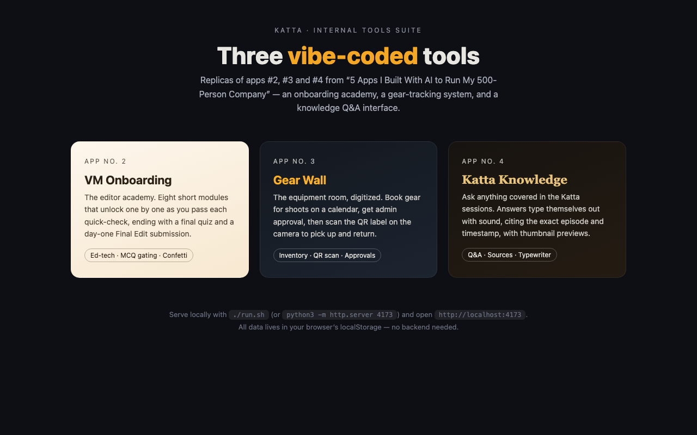
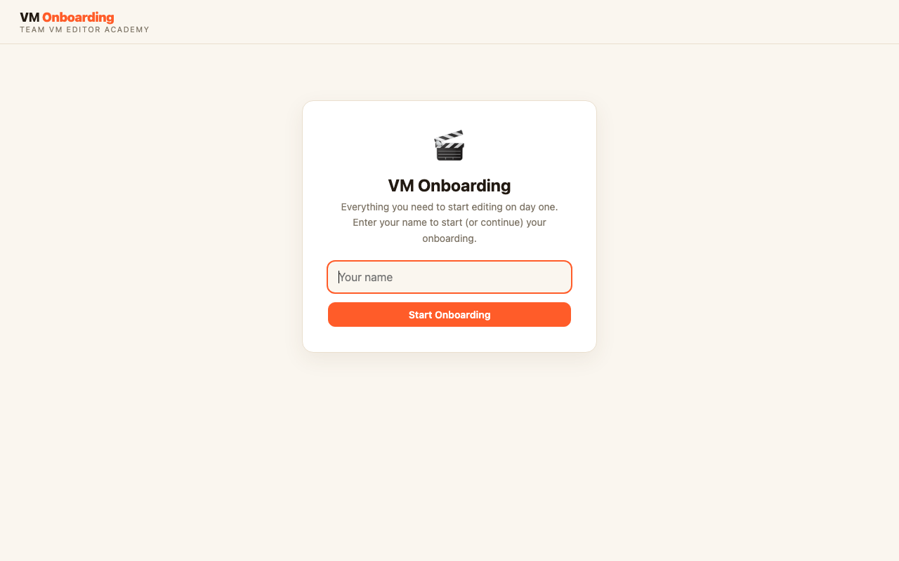
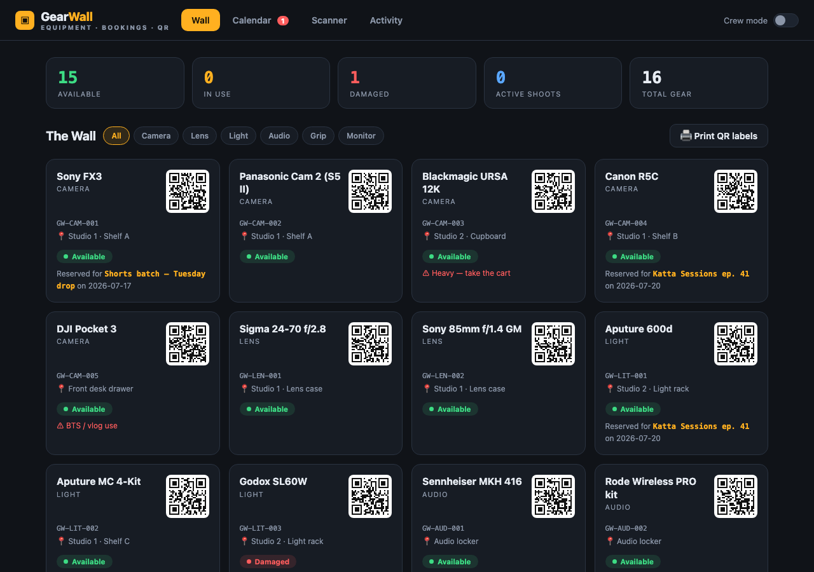
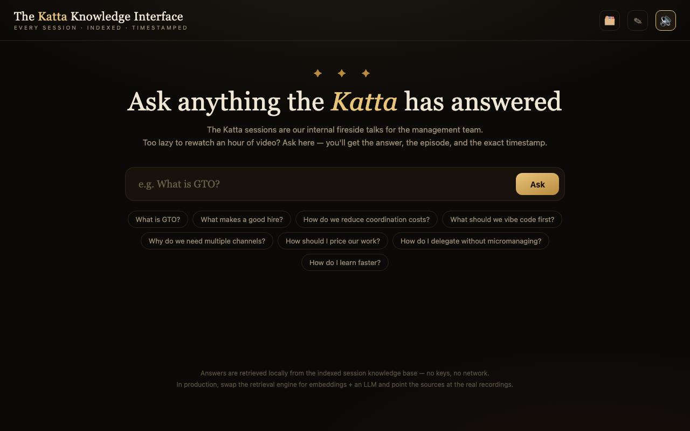
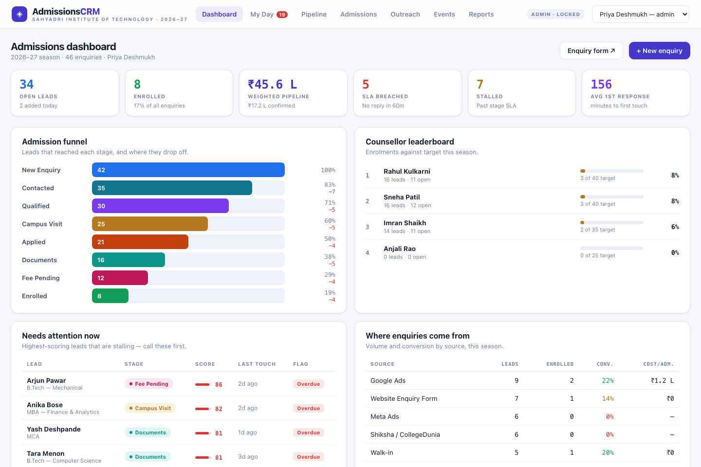

# Katta — Production-Ready Internal Tools Suite

Four sellable web apps. Three born as replicas of apps #2, #3 and #4 from Varun Mayya's
video [*"5 Apps I Built With AI to Run My 500-Person Company"*](https://www.youtube.com/watch?v=M1E4ZzdpOco)
and rebuilt to production grade, plus an **Admissions CRM for schools & colleges**
designed from market research to be sold on its own. House rule throughout:
**nothing hard-coded, every entity editable in-app, and all persistence behind a
swappable database layer.**



## Quick start

```sh
./run.sh          # serves everything at http://localhost:4173
```

or `python3 -m http.server 4173` from this folder. Serving over `localhost` also
enables the camera for Gear Wall's QR scanner. Default manager/lead/curator PIN
everywhere: **1234** (change it in each app's Settings).

## The architecture: database-ready by design

Each app has the same three-file data layer:

| File | Role |
|---|---|
| `config.js` | The **only** file you touch to deploy: pick the adapter, set org namespace |
| `store.js` | `Store` facade + two adapters: `LocalAdapter` (localStorage, default) and `RestAdapter` (any HTTP backend) |
| `seed.js` | Demo dataset, loaded only when the DB is empty; `Settings → Reset demo data` reloads it |

**All app code calls `Store.list / put / remove / getMeta / setMeta` asynchronously** —
no code change is needed to move from browser storage to a real database.

### Connecting a real database

Implement six endpoints (any stack — Express+Postgres, Supabase edge functions, Firebase):

```
GET    {api}/{collection}          → [docs]
PUT    {api}/{collection}/{id}     → upsert doc (JSON body)
DELETE {api}/{collection}/{id}
GET    {api}/meta/{key}            → value
PUT    {api}/meta/{key}            → { value }
POST   {api}/admin/clear           (optional, for reset)
```

then flip one file:

```js
// config.js
window.APP_CONFIG = { adapter: "rest", apiUrl: "https://api.youragency.com/gearwall", apiToken: "…" };
```

Migration path: every app's Settings has **Export backup (JSON)** — import that
dump into your database and you're live. Auth note: PIN-gating is a UX gate for
trusted teams on a LAN; when you attach a real backend, enforce roles server-side
with the `Authorization` header the RestAdapter already sends.

---

## App No. 2 — Onboarding Academy  (`vm-onboarding/`)

Sellable to marketing/creative agencies: converts their process documents into
interactive training. 

**Learner side** — profile picker (or self-join), multiple course tracks, modules
that unlock one-by-one via quick-check MCQs (confetti included), wrong answers
logged as gaps, final quiz with pass mark, then a practical assignment with a
self-checklist and link submission. Feedback loop: leads request changes → the
trainee sees exactly which checklist items failed → fix & resubmit → approved.

**Lead side** (PIN-gated): progress dashboard with most-missed questions and CSV
export · review queue with per-checklist-item gap marking and feedback · **full
course builder** (create courses, author modules with sections + quizzes, edit
final quiz in a plain-text format, edit the assignment checklist, reorder,
publish/unpublish) · people management · settings + JSON backup/import/reset.

## App No. 3 — Gear Wall  (`gear-wall/`)

Sellable to photo/video production companies: the equipment room, digitized.


- **The Wall** — live status per item (available / in use / damaged), who has it,
  for which shoot, for how long; overdue returns flagged in red; serials, home
  location and internal day-rates on every card; printable QR labels.
- **Bookings with date ranges + conflict detection** — the booking form flags gear
  already committed in your date window (hard-block on approved clashes, warning
  on pending ones); approval re-checks conflicts before committing.
- **Roles** — member profiles (crew/manager); manager actions (approve/reject,
  add/edit/archive gear, damage/repair, projects, team, settings) behind a PIN.
- **QR scan pickup & return with condition tracking** — condition recorded on the
  way out and back; a damaged return takes the item out of service automatically.
- **Projects/clients CRUD**, cost estimates per booking from day-rates, usage
  history + event log, **CSV exports** (inventory + usage), JSON backup/import.

## App No. 4 — Katta Knowledge  (`katta-knowledge/`)

Q&A over indexed session recordings with cited timestamps.


- Ask box with typewriter answers + WebAudio sound, sources with exact
  timestamp chips and hover thumbnail previews, question history.
- **Curator panel** (PIN-gated): add/edit/remove episodes in a simple text
  format (`@ MM:SS | keywords…` + answer text), JSON export/import — the
  knowledge base is data, not code.
- The local retrieval engine is one function (`search()` in `app.js`); swap it
  for embeddings + an LLM without touching the UI.

## Product No. 5 — Admissions CRM  (`CRM/`)

Sellable to schools, colleges and coaching institutes: the whole admission
funnel from enquiry to enrolment. 

- **Pipeline board** (drag & drop) over a fully editable stage list, with a
  table view and bulk reassign / stage-move / follow-up.
- **Lead 360** — timeline of every call/WhatsApp/email/visit, document
  checklist (missing → received → verified), fee ledger with auto receipts,
  template messages with per-lead merge preview.
- **Lead scoring + SLAs** — five tunable signals rank every queue; a
  first-response timer and per-stage stall limits make slow follow-up visible.
- **My Day** — each counsellor's answer to "who do I call right now?"
- **Admissions desk** — document verification queue and fee collection desk.
- **Events with ROI** — fast registration-desk capture, cost-per-admission.
- **Reports** — funnel drop-off, loss reasons, source ROI, counsellor
  performance, programme demand vs seats.
- **Public enquiry form** (`CRM/enquiry.html`) — embeddable, writes into the
  same store, auto-assigns to the least-loaded counsellor, dedupes repeats.
- **CSV import** with duplicate skipping, JSON backup/restore, CSV exports.

See [`CRM/README.md`](CRM/README.md) for the market research it's built on
(Slate's $30k floor, the "no dedicated admin" wedge) and the sales pitch.

---

## Outreach package  (`outreach/`)

- [`prospects-gearwall.md`](outreach/prospects-gearwall.md) — **287 real companies**
  (Maharashtra 107 · Karnataka 79 · rest of India 101): production houses, studios,
  wedding filmers, rental houses — with city, segment and a one-line need hook.
- [`prospects-onboarding.md`](outreach/prospects-onboarding.md) — **311 real
  companies** (Maharashtra 119 · Karnataka 73 · rest of India 119): digital,
  creative, branding, influencer and PR agencies.
- [`email-templates.md`](outreach/email-templates.md) — cold-outreach templates
  for both apps, follow-up sequence, personalization formula, sending checklist.
- [`sample-drafts.md`](outreach/sample-drafts.md) — two fully personalized
  ready-to-send examples.
- **`mailmerge-gearwall.csv` / `mailmerge-onboarding.csv`** — every one of the 287
  + 311 companies as a mail-merge row with its own subject line and a complete,
  personalized founder-voice email body, ready to load into a Gmail mail-merge tool.
- [`email-final-gearwall.md`](outreach/email-final-gearwall.md) /
  [`email-final-onboarding.md`](outreach/email-final-onboarding.md) — the polished
  founder-voice email each CSV is built from; [`build_mailmerge.py`](outreach/build_mailmerge.py)
  regenerates the CSVs after you edit the signature.
- [`HOW-TO-SEND.md`](outreach/HOW-TO-SEND.md) — send them one by one from your own
  Gmail with a mail-merge add-on (Claude can't send email; this is the working path).

## Testing

`.tests/harness.html` drives all four apps end-to-end in headless Chrome —
including the course builder, review workflow, booking conflict detection,
QR pickup/return with conditions, PIN gates, curator authoring, and the full
CRM flow (seeding, capture, dedupe, board moves, lost/enrol, documents,
payments, CSV import, public form): **69/69 checks passed** at build time.
Run it at `http://localhost:4173/.tests/harness.html`.

## Tech

Vanilla HTML/CSS/JS, no build step. Vendored: `qrcode-generator` + `jsQR`
(`gear-wall/vendor/`). Hand-rolled: data-access layer, confetti, calendar,
conflict engine, typewriter, WebAudio, SVG thumbnails, retrieval engine.
